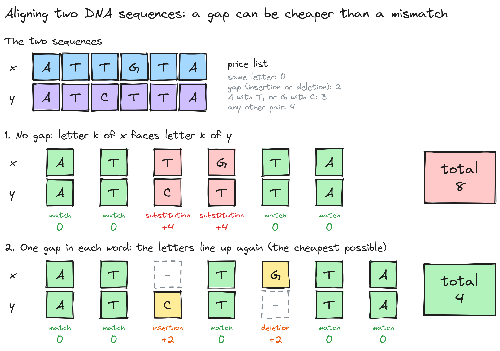
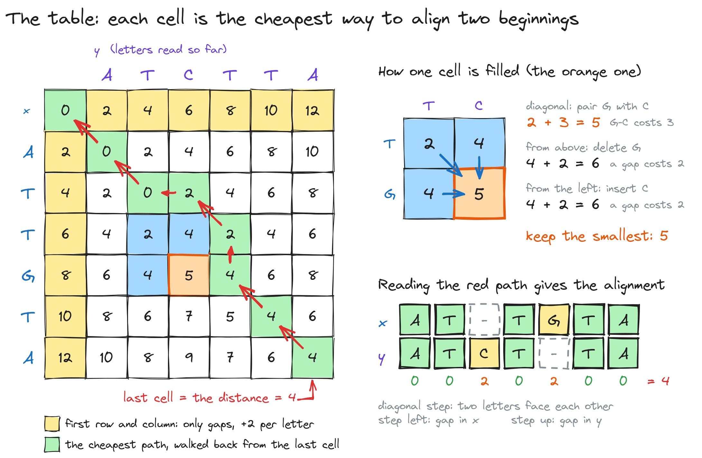
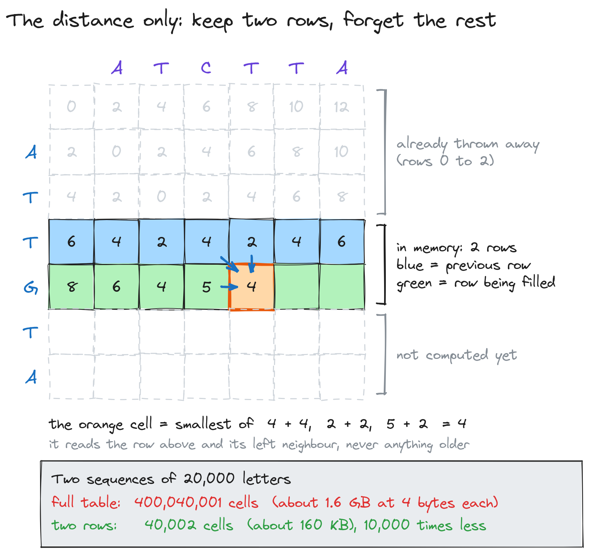
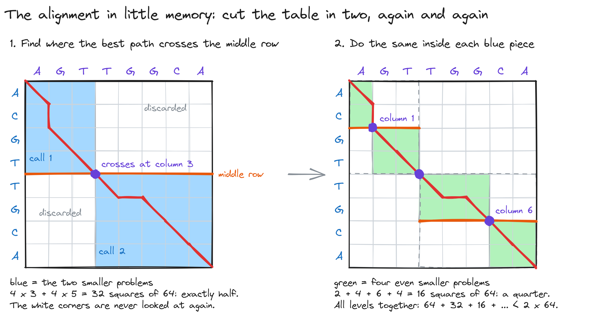
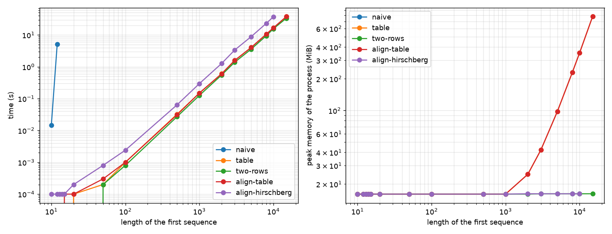

# DNA sequence alignment

[](https://github.com/mbenimam/DNAsequencing/actions/workflows/tests.yml)


Two DNA sequences go in. Out comes the cheapest way to turn one into the other, and the proof of it: the two sequences written one above the other, with gaps where a letter was inserted or lost.

I wrote it four ways, from the one that gives up at 13 letters to the one that aligns 10,000 letters in **16 MiB** where the textbook table needs **352 MiB**.

| | |
|---|---|
| **What it is** | A Python package and command-line tool for the global alignment of two DNA sequences |
| **The hard part** | Producing the alignment itself, not only its cost, without keeping a table of n × m cells |
| **Result** | Sequences of 10,000 letters aligned in 16 MiB of memory (measured), against 352 MiB for the full table |
| **Stack** | Python 3.10+, no runtime dependency, pytest, GitHub Actions |
| **Checked by** | 13 tests: every method must agree with brute-force enumeration, and every alignment must be valid and optimal |



## What the project is

DNA can be read as a text over four letters: A, C, G and T. When a gene is copied from one generation to the next, a letter is sometimes replaced, lost, or added. So two genes with a common ancestor look like two versions of the same text with a few edits between them. Measuring how many edits separate two sequences is how biologists judge whether they are related.

This project answers two questions about a pair of sequences:

1. **How far apart are they?** The *edit distance*: the lowest total price of the edits that turn the first into the second.
2. **Which edits?** An *alignment*: the two sequences written in two rows of the same length, with gaps added so that related letters face each other.

Each kind of edit has a price. Here a gap costs 2, replacing A by T or G by C (or the reverse) costs 3, any other replacement costs 4, and two equal letters cost nothing. In the picture above, facing the letters one to one costs 8. Sliding the middle with one gap in each row costs 4, and nothing does better.

The project started as a university algorithms project in 2019. The repository now holds four methods and the measurements that compare them.

### Words used in this README

- **Sequence**: a string of the letters A, C, G, T.
- **Gap**: a blank (`-`) placed in one row of an alignment, facing a letter in the other row.
- **Insertion / deletion**: a letter that faces a gap. It costs 2 either way.
- **Substitution**: two different letters facing each other.
- **Alignment**: two rows of equal length that spell the two sequences when the gaps are removed, with no column made of two gaps.
- **Edit distance**: the cost of the cheapest alignment.
- **Global alignment**: the whole of one sequence is aligned with the whole of the other.
- **Dynamic programming**: solving a problem by filling a table of answers to smaller versions of it, each computed once.

## The four methods

### 1. Try everything

The first method builds every possible alignment, one column at a time, and keeps the best cost. It is the easiest to trust and the first to fail: two sequences of 10 letters already have millions of alignments. On my machine it needs 1.3 s for 10 letters, 16 s for 12, and it does not finish 13 letters in a minute. I keep it because it is the referee: every faster method must return the same distance.

### 2. Fill a table

The trick is to notice that the cheapest alignment of two beginnings can be built from the cheapest alignments of shorter beginnings. The last column of any alignment is one of three things: two letters, a letter above a gap, or a gap above a letter. So each cell of a table needs only its three neighbours.



The last cell is the distance. Walking back from it, always to a neighbour that explains the current value, spells out an optimal alignment. This is the classic Needleman–Wunsch method. It takes time and memory proportional to n × m, and the memory is what hurts: 352 MiB at 10,000 letters, 781 MiB at 15,000.

### 3. Keep two rows

A cell reads the row above and its left neighbour, nothing older. If only the distance is wanted, every row but the last one can be thrown away as soon as the next is filled.



Same time, almost no memory: the process stays at 16 MiB, which is the size of the Python interpreter itself. The cost is that the walk back is no longer possible, so this gives the distance and not the alignment.

### 4. Cut the table in two, again and again

This is the part I like most. To get the alignment back without the table, find the one place where the best path crosses the middle row. That takes one pass with two rows. Then the problem splits into two smaller ones, top-left and bottom-right, and the rest of the table is never looked at again.



The two pieces together cover half of the table, the next level a quarter, and so on, so the total work is less than twice one full pass. This is Hirschberg's idea. In the measurements it costs about 2.2 times the time of the full table and keeps the memory flat.

## Measured

All 58 instance files, one fresh process per run, 60 seconds allowed per run, pure Python 3.14 on a Ryzen 5 5600. Times are averages over the instances of a size. Memory is the peak memory of the whole process, which is 16 MiB for an empty Python interpreter.

| Letters | Try everything | Table (distance) | Two rows | Table + walk back | Cut in two |
|---:|---:|---:|---:|---:|---:|
| 10 | 1.3 s | < 1 ms | < 1 ms | < 1 ms | < 1 ms |
| 12 | 15.9 s | < 1 ms | < 1 ms | < 1 ms | < 1 ms |
| 13 | over 60 s | < 1 ms | < 1 ms | < 1 ms | < 1 ms |
| 1,000 | | 0.15 s, 16 MiB | 0.13 s, 16 MiB | 0.15 s, 16 MiB | 0.30 s, 16 MiB |
| 5,000 | | 4.1 s, 98 MiB | 3.6 s, 16 MiB | 4.2 s, 98 MiB | 8.9 s, 16 MiB |
| 10,000 | | 17.0 s, 352 MiB | 15.8 s, 16 MiB | 17.0 s, 352 MiB | 37.7 s, 16 MiB |
| 15,000 | | 38.6 s, 781 MiB | 33.9 s, 16 MiB | 38.4 s, 781 MiB | over 60 s |
| 20,000 | | over 60 s | over 60 s | over 60 s | |



What the numbers say:

- **Time grows with the square of the length** for the three table methods: doubling from 5,000 to 10,000 letters multiplies the time by about 4.2.
- **Memory is the real difference.** The full table grows with the square of the length. The two linear-memory methods never leave the interpreter's 16 MiB.
- **Saving memory costs time, by a constant factor.** Cutting in two is about 2.2 times slower than walking back through the full table.
- **The limit here is Python, not the algorithm.** The instance files go up to 100,000 letters. In pure Python, 20,000 letters already takes more than a minute, so the largest files are out of reach of this implementation. A compiled inner loop is the next step.

The raw results are in [`bench/results.csv`](bench/results.csv). `align bench --plot` regenerates the table and the figure.

## Run it

You need [uv](https://docs.astral.sh/uv/).

```bash
git clone https://github.com/mbenimam/DNAsequencing.git
cd DNAsequencing
uv sync --group dev

uv run align distance data/Inst_0000010_7.adn          # 8
uv run align align data/Inst_0000010_7.adn
uv run pytest -q                                        # 13 passed
```

```
TGGGTGCTAT
 |||| ||||
GGGGTTCTAT

cost 8, length 10
```

Other commands:

```bash
uv run align distance <file> --method naive|table|two-rows
uv run align align <file> --method table|hirschberg
uv sync --group bench && uv run align bench --plot      # about 25 minutes
```

An instance file has four lines: the two lengths, then the two sequences with letters separated by spaces.

## How it is checked

- The three reference instances return the known distances 10, 8 and 2 with every method.
- On 300 random pairs, the table and the two-row method return the same distance as brute-force enumeration.
- On 400 random pairs, both alignment methods return rows that are a valid alignment and whose cost equals the distance. Validity and cost are checked by separate code that knows nothing about the algorithms.
- The cut found by the fourth method splits each of 300 random pairs into two halves whose distances add up to the whole.
- Empty sequences and single letters are covered.

## Layout

```
src/align/
  costs.py        the price of each edit
  naive.py        method 1: enumeration
  dp.py           method 2: the table and the walk back
  linear.py       method 3: two rows
  hirschberg.py   method 4: cut in two
  check.py        independent validity and cost checks
  bench.py        the benchmark
  cli.py          the align command
tests/            pytest
data/             58 instance files, 10 to 100,000 letters
bench/            measured results and figure
doc/              the original project brief (in French)
```

## Status

Global alignment is complete and tested. Local alignment, which looks for the best matching region inside two sequences, is not implemented.

## License

MIT
